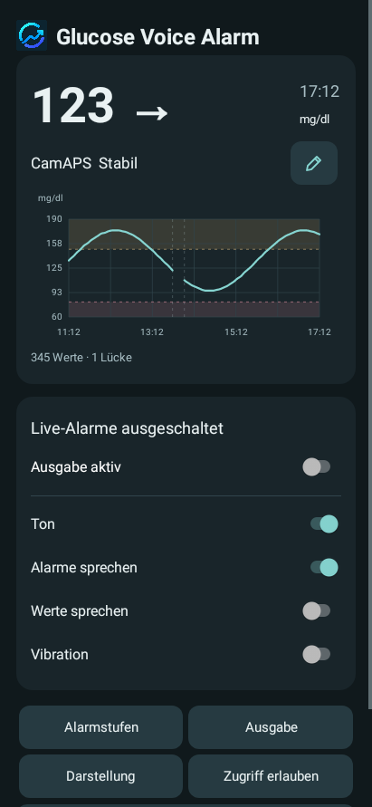
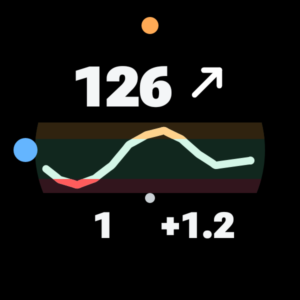
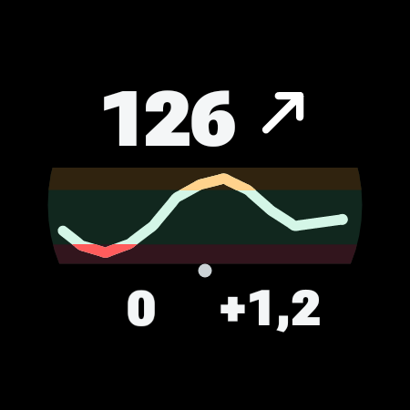

# Glucose Voice Alarm

[English](README.md)

Glucose Voice Alarm (GVA) liest Glukosewerte und Trendpfeile aus **CamAPS-Benachrichtigungen** auf einem Android-Telefon. Die App zeigt sie auf dem Telefon und unter Wear OS an und gibt eigene Alarme über konfigurierbare **Töne, Sprache und Vibration** aus. Wertansagen, Alarmstufen, Ausgabekanäle und einzelne gesprochene Texte lassen sich anpassen.

**Experimentelle Beta. Ausschließlich Forschungswerkzeug. Nicht für medizinische Verwendung. Kein zertifiziertes Medizinprodukt.** Werte und Alarme können fehlen, verspätet oder falsch sein. Nicht für Therapie- oder Dosierungsentscheidungen verwenden. Lies vor dem Bauen und Verwenden die [Sicherheitshinweise](SAFETY.de.md).

## Drei APKs, ein gemeinsames Projekt

| Komponente | Aktueller Quellstand | Aufgabe |
|---|---|---|
| [Glucose Voice Alarm — Telefon](companionProbe/README.de.md) | 0.20.5 Beta | CamAPS-Empfang, konfigurierbare Alarme und Sprache, Dashboard, AOD/Sperrbildschirm und Widget |
| [GVA Watch](companionWear/README.de.md) | 0.19.0 Beta | Uhrenanzeige, Kachel, sechs Komplikationsquellen und optionale Telefonalarme mit Uhrenvibration |
| [GVA Dots](companionWatchFace/README.de.md) | 0.1.5 Beta | Rundes Zifferblatt mit Uhrzeitpunkten, Wert/Pfeil, kurzem Verlauf, Alter und Delta |

Kachel und Komplikationen sind in **GVA Watch** enthalten. Sie sind keine eigenen Apps. Das Telefon funktioniert ohne Uhr; GVA Dots benötigt GVA Watch für die Daten. Gemeinsame Quellen halten Anzeige- und Alarmprotokolle zusammen. Telefon und Uhren-App müssen dieselbe App-ID und denselben Signierschlüssel verwenden.

## Wege für Informationen und Alarme

| Ort | Informationen | Alarmausgabe |
|---|---|---|
| Telefon-App | Wert, CamAPS-Pfeil, Delta und Sechs-Stunden-Diagnosekurve | Alarmstufen und Ausgabeeinstellungen |
| Telefon-Audio und Haptik | Optionale normale Wert-/Trendansagen | Kurze Töne, gesprochene Alarmtexte und Vibration, getrennt einstellbar |
| Telefon-AOD / Sperrbildschirm / Statusleiste | Wert und Trend; kompakte Statusleistenzahl, soweit unterstützt | Android-Benachrichtigungen; die Sichtbarkeit bestimmt Android |
| Startbildschirm-Widget | Wert, Pfeil, adaptive Kurve, Delta und ursprüngliche Empfangszeit | Optionale Kanal-/Ausgabeschalter; keine eigene Alarmberechnung |
| Uhren-App und GVA Dots | Wert, Pfeil, Ein-/Zwei-Stunden-Verlauf, Alter und Delta; gedimmte Ansicht | Optionale Weiterleitung der Telefonalarme/Lückenwarnungen mit Uhrenvibration |
| Uhrenkachel und andere Zifferblätter | Kachel sowie Sammelfeld und einzelne Komplikationsquellen | Nur Anzeige; weitergeleitete Benachrichtigungen verarbeitet GVA Watch |

CamAPS bleibt Sensor- und Pumpencontroller. GVA verändert keine Therapieeinstellungen. Es ergänzt Ausgabe- und Darstellungswege für die verfügbaren Quelldaten.

## Beispiele

Alle Beispiele enthalten **synthetische Daten**, keine persönlichen Messwerte. Bei den Bildern sind native App-Renderings, Zifferblattvorschauen und Schemata unterschieden.

<table><tr><td valign="top"> Telefon-Dashboard</td><td valign="top"> GVA Dots · aktive Vorschau</td><td valign="top"> GVA Watch · Kachel</td></tr></table>

[Telefon-AOD, Widget und Einstellungen](companionProbe/README.de.md#beispiele) · [Kachel und alle sechs Komplikationen](companionWear/README.de.md#beispiele) · [Aktives und gedimmtes Zifferblatt](companionWatchFace/README.de.md#beispiele) · [Bildnachweise](docs/images/README.md)

## Was sich einstellen lässt

- Hoch-, Niedrig-, Dauerhaft-hoch- und kritische Anstiegs-/Fallratenalarme; mehrere Stufen, wo unterstützt, Wiederholung/Snooze und optionale Erholungsunterdrückung.
- Ton, Alarm-Sprache, normale Wertansagen und Vibration, dazu ein getrennter Hauptschalter. Mindestens ein wirksamer Alarmweg muss konfiguriert bleiben.
- Ansagevorlagen, jedes der sieben Trendwörter und der Text der Lückenwarnung; einzelne Trendwörter können stumm bleiben.
- Drei Glockentonsets, eigene Android-Töne, Vibrationsmuster, relative Lautstärken, fünf lokale Einstellungsprofile sowie Deutsch/Englisch für Oberfläche und Standardansagen.
- mg/dl oder mmol/l, Hell/Dunkel/System, getrennte Uhrenfreigaben und Widget-Bedienung. Details im [Telefonhandbuch](docs/PHONE_REFERENCE.de.md).

## Bauen und einrichten

Dies ist ein **reines Quellprojekt**. Es gibt keine gepackten APK-Releases oder Store-Downloads. Folge der [Bauanleitung](docs/BUILDING.de.md) und der Einrichtung der jeweiligen Komponente. Ein privater Entwicklerschlüssel ist nicht nötig. Bewahre Deinen eigenen Signierschlüssel für Updates auf und verwende ihn für Telefon und Uhren-App gemeinsam.

Beide Apps verlangen die persönliche Bestätigung ihrer Warnhinweise und Nutzungsbedingungen. Benachrichtigungszugriff, Hintergrundfreigaben und Ausgabe müssen bewusst eingeschaltet werden. Updates unterbrechen die Telefon-Ausgabe; danach selbst wieder einschalten.

## Wichtige Grenzen

- Entwicklung und Geräteprüfungen konzentrieren sich auf Pixel 7 Pro mit Android 17/CamAPS FX 1.4(194).111 sowie Galaxy Watch5 Pro mit Wear OS 6. Andere Telefone, Launcher, Uhren und CamAPS-Versionen benötigen eigene Tests.
- Die große Telefon-AOD-/Live-Anzeige verwendet Android-17-Unterstützung, sofern verfügbar. Ältere Systeme erhalten eine normale Benachrichtigung. Platzierung, Priorisierung, Takt und Hintergrundbeschränkungen bestimmt Android.
- Zeiten sind Empfangszeiten, keine bestätigten Sensor-Messzeitpunkte. Fehlende Werte werden nicht extrapoliert. CamAPS-Pfeil und kritische numerische Ratenalarme beschreiben unterschiedliche Dinge.
- Die Uhrenübertragung nutzt Google Play services Data Layer und verbundene Geräte in der Nähe. Die Uhr berechnet keine eigenen Glukosealarme. Bei Verbindungsfehlern können weitergeleitete Alarme fehlen; es gibt keine Offline-Nachholung. Aktualisierungstakt von Komplikationen/Kachel und Akkuverbrauch müssen weiter am Gerät geprüft werden.

Der [aktuelle Stand mit offenen Punkten](docs/STATUS.md) trennt synthetische Prüfungen von Gerätebeobachtungen. Diese Tests belegen keine klinische Sicherheit oder verlässliche Alarmzustellung.

## Lizenz und Credits

GVA-Quellen stehen unter [GPL-3.0-or-later](LICENSE); xDrip-Urheberschaft und Herkunftsnachweise bleiben erhalten. Schriften und externe Abhängigkeiten behalten ihre eigenen Lizenzen. Siehe [Credits](CREDITS.md), [Drittlizenzen](THIRD_PARTY_NOTICES.md) und [übernommene xDrip-Regeln](docs/UPSTREAM.md). Produktnamen benennen Kompatibilität, keine Zugehörigkeit oder Unterstützung durch deren Hersteller.
