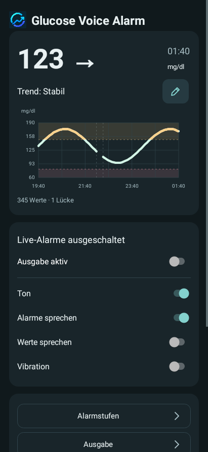
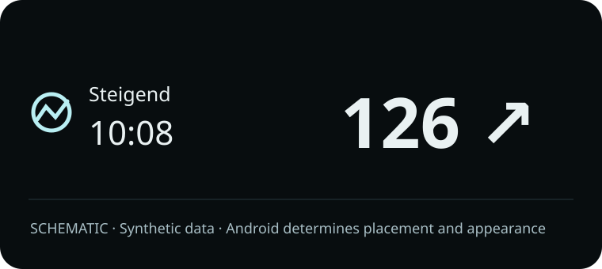
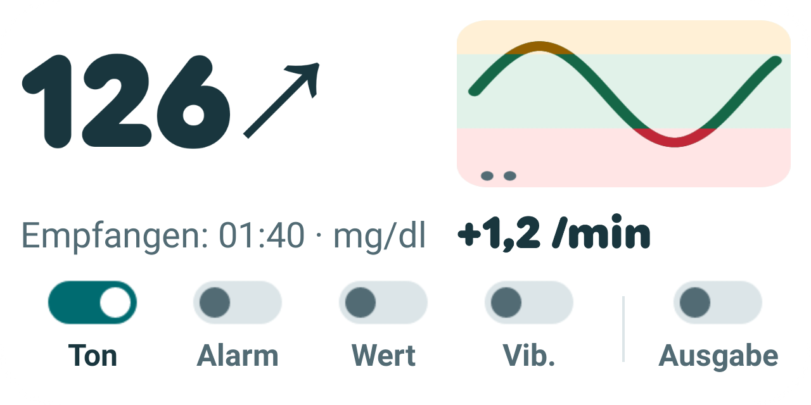
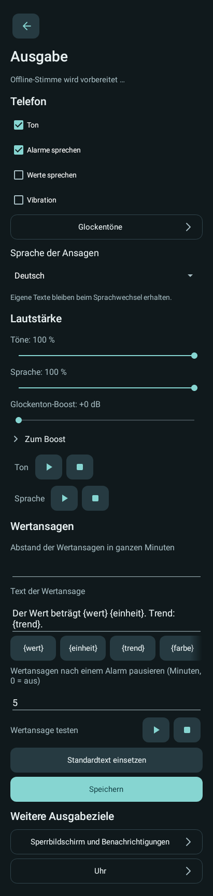
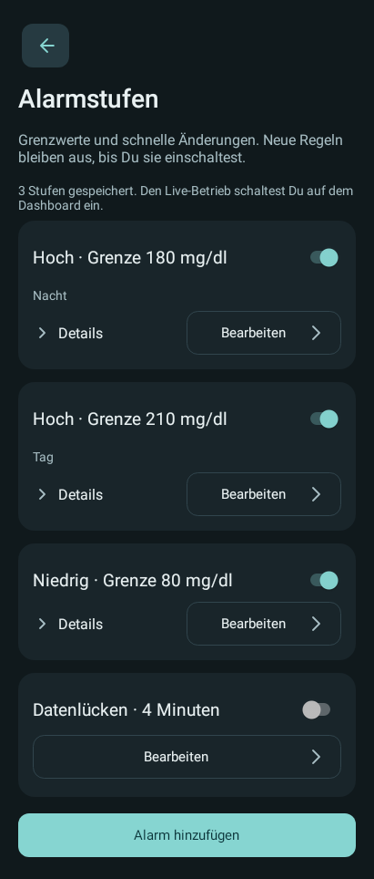
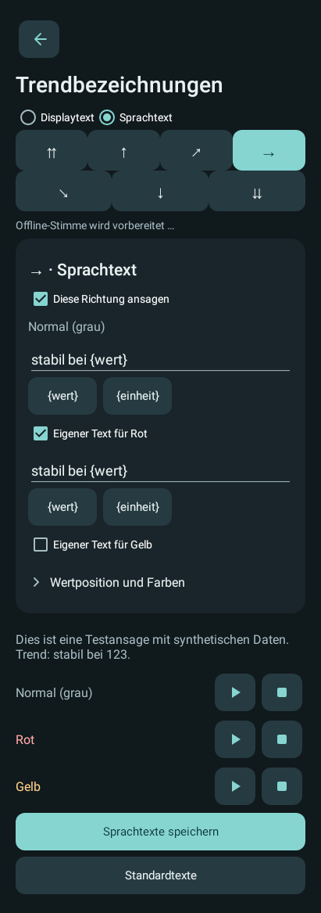

# Glucose Voice Alarm — Telefon

[Projektübersicht](../README.de.md) · [English](README.md) · [GVA Watch](../companionWear/README.de.md) · [GVA Dots](../companionWatchFace/README.de.md)

Die Telefon-App empfängt unterstützte CamAPS-Benachrichtigungen, prüft ihre eingestellten Alarme und versorgt die anderen GVA-Anzeigen. Version **0.30.0 Beta**. Sie funktioniert ohne die beiden Uhrenkomponenten.

**Experimentelles Forschungswerkzeug; nicht für medizinische Verwendung oder Therapieentscheidungen.** Lies [SAFETY.de.md](../SAFETY.de.md). CamAPS steuert weiterhin Sensor und Pumpe.

## Beispiele

Synthetische Beispiele. Dashboard und Einstellungen sind native App-Renderings; die AOD-Grafik ist ein Schema der an Android übergebenen Informationen, kein Pixel-Screenshot. Das tatsächliche Aussehen bestimmt Android.

<table><tr><td valign="top"> Dashboard</td><td valign="top"> AOD · Schema   Widget · hell</td></tr></table>

Einstellungsbeispiele

<table><tr><td valign="top"> Ausgabe</td><td valign="top"> Alarmstufen</td><td valign="top"> Trendbezeichnungen</td></tr></table>

Jedes Widget hat eine Vorschau und eigene System-, App- oder selbst gewählte Farben. Hintergrund- und Kurvendeckkraft sowie seitliche und vertikale Innenabstände sind getrennt einstellbar. Du wählst eine oder zwei Stunden; ein oder zwei Punkte in der Kurvenfläche zeigen den Zeitraum. Die höhere Kurve erhält die bisherige Wert-/Pfeilgröße und lässt Abstand zum Delta darunter. Die ursprüngliche Empfangszeit folgt der App-Sprache. Wert/Pfeil öffnen CamAPS, die Kurvenfläche öffnet GVA; ohne verfügbare CamAPS-App führt auch der linke Bereich zu GVA. Die optionale Schalterzeile steuert Ton, Alarm-Sprache, Wertansagen, Vibration und Ausgabe. Fehlt eine Voraussetzung, öffnet der betreffende Schalter die Einrichtung.

## Ausgabe und Einstellungen

Mehrere Alarmstufen behalten ihre eigenen Ton-, Sprach- und Vibrationswege sowie Wiederholung und Snooze, soweit für die Alarmart vorgesehen. Normale Wertansagen haben ein eigenes Intervall und können nach Alarmen pausieren. Fünf lokale Profile speichern Ausgabe und Anzeigetexte. Details im [Telefonhandbuch](../docs/PHONE_REFERENCE.de.md).

Die Hauptnavigation trennt Alarmstufen, Ausgabe, Trendbezeichnungen, Android-Freigaben, Profile, Verlauf & Diagnose und allgemeine Einstellungen. Alarmstufen erscheinen zunächst kompakt, nach Art und Grenze sortiert. Ein gemeinsamer Hinzufügen-Button öffnet die Alarmartauswahl. Löschen steht im jeweiligen Stufeneditor und verlangt eine Bestätigung. Die Sechs-Stunden-Kurve hat eine kräftigere Linie mit derselben Grenzwertfärbung wie das Widget.

Unter Trendbezeichnungen wählst Du Display- oder Sprachtext und eine Richtung. Die Reihenfolge ist überall ⇈, ↑, ↗, →, ↘, ↓, ⇊. Rot und Gelb übernehmen zunächst den normalen Text und können eigene Texte erhalten. Display und Sprache werden getrennt gespeichert. In gesprochenen Trendtexten sind {wert}/{value} und {einheit}/{unit} erlaubt. Enthält der gewählte Trendtext die Wertvariable, verschiebt sich der Wert dorthin; der bisherige Wertteil wird entfernt. Ohne Wertvariable bleibt die bestehende Wertansage erhalten. Die Vorschau zeigt und spricht synthetische Daten.

Die Anzeige unterscheidet „Trend offen“ ohne Pfeil von „Pfeil zuordnen“ bei einer vorhandenen, noch nicht zugeordneten Grafik. Im Dashboard lautet die Zeile „Trend: offen“ beziehungsweise „Trend: Pfeil zuordnen“. Unbekannte Trends bleiben beim Sprechen ausgelassen. Bei veralteten Daten zeigt die AOD-Anzeige weiterhin das Alter.

Android-Freigaben stehen einzeln mit grünem Häkchen, rotem Ausrufezeichen oder neutralem Status für nicht verfügbare beziehungsweise nicht prüfbare Funktionen. Unter Verlauf & Diagnose lassen sich Empfang und Ausgaben prüfen sowie ein technischer Kurzbericht bei Bedarf kopieren. Ausgabevorschauen haben dieselben Play-/Stop-Elemente. Die Einstellungen und Profile bleiben beim Update erhalten; die Ausgabe schaltest Du anschließend selbst wieder ein.

## Farbige Pfeile und eigene Trendtexte

Die Pfeilzuordnung zeigt sieben Richtungen mit je drei Farben in einem kompakten Raster. Das aktuelle Quellbild bleibt darüber sichtbar; die Auswahl scrollt getrennt von den Aktionen. Rot und Gelb müssen ausdrücklich für die konkrete Grafik zugeordnet werden. Eine ähnliche Form allein bestätigt keine Farbe. Vorhandene Zuordnungen bleiben normal, bis Du die betreffende Grafik neu zuordnest.

CamAPS verwendet einen farbigen Hintergrund um den weißen Pfeil. GVA färbt stattdessen den Pfeil selbst. Frische Pfeile können normal, rot oder gelb sein; veraltete Daten bleiben grau. Die Trendzeile verwendet „Trend:“ statt eines festen Quellnamens.

Unter Trendbezeichnungen → Displaytext bearbeitest Du die sichtbaren Wörter, unter Trendbezeichnungen → Sprachtext getrennt davon die gesprochenen Wörter. Für jede der sieben Richtungen übernehmen Rot und Gelb zunächst den normalen/grauen Text. Mit der jeweiligen Farb-Checkbox aktivierst Du einen eigenen Text. Beim ersten Einschalten wird ein leeres Feld mit dem aktuellen Basistext vorbelegt. Ausschalten bewahrt den eigenen Text und folgt wieder dem Basistext; ein aktives leeres Feld folgt ebenfalls der Basis. Anzeigetexte erlauben bis zu 40, Sprachtexte bis zu 80 Zeichen, jeweils einzeilig. Displaytexte sind wörtlich; Sprachtexte erlauben `{wert}`/`{value}` und `{einheit}`/`{unit}`. Ein gesetzter Wertplatzhalter verschiebt die Wertansage an diese Stelle; ohne ihn bleibt der Wertteil der bestehenden Ansage erhalten. Die Sprach-Schalter für eine Richtung gelten für alle ihre Farben. Profile speichern beide Textgruppen samt Farbaktivierung.

Der optionale Platzhalter `{farbe}` (auch `{color}`) ergänzt in unterstützten Ansagetexten „rot“ oder „gelb“; bei normalen oder unbekannten Pfeilen bleibt er leer. Beispiel: `{wert} {trend} {farbe}`. Die Farbe wird nicht automatisch an das Trendwort angehängt; vorhandene Ansagetexte bleiben erhalten. Eigene Farbtexte und dieser Platzhalter sind unabhängig voneinander.

## Bald niedrig

Unter Alarmstufen → Alarm hinzufügen → Bald niedrig legst Du eine eigene Warnstufe an. Neue Stufen sind ausgeschaltet. Der Grundtext lautet „Laut Datenquelle bald niedrig“ und lässt sich ändern. Du wählst Zeitfenster, Ton, Sprache und Vibration; es gibt keine eigene Zahlengrenze, Wiederholung oder Snooze-Einstellung.

Diese Warnung verwendet ausschließlich einen frisch empfangenen, erkannten roten Pfeil beliebiger Richtung als Quellhinweis. Zusätzlich muss der Wert strikt oberhalb der höchsten eingeschalteten Niedrig-Grenze liegen, deren Zeitfenster gerade gilt. Ohne aktive Niedrig-Stufe gibt es keine Ersatzgrenze. An oder unter dieser Grenze ist der vorhandene Niedrig-Alarm zuständig. GVA berechnet dafür keine eigene Vorhersage aus Änderungsrate oder Pumpendaten.

Die Warnung kommt einmal pro roter Phase. Ein neuer eindeutig normaler oder gelber Pfeil gibt sie für die nächste rote Phase wieder frei. Unbekannte Pfeile, Datenlücken, ein niedriger Wert oder ein Neustart setzen diese Sperre nicht zurück. Es gibt keine zeitgesteuerte Wiederholung. Die üblichen Frischeprüfungen, Ausgabeschalter, Pausen und Zeitfenster gelten weiterhin. Wird die Warnung wegen eines aktuell gesperrten Ausgabewegs noch nicht gestartet, kann sie bei später erfüllten Bedingungen innerhalb derselben roten Phase starten.

## Dauerhoch-Zeit

Die Dauer beginnt mit dem ersten empfangenen gültigen Wert über der Grenze dieser Dauerhoch-Stufe. Sie läuft über gleichbleibende oder fallende Werte und über Datenlücken hinweg weiter. Ein frischer Wert an oder unter dieser Grenze beendet die Phase. Fehlende, ungültige oder veraltete Daten bestätigen kein Ende.

Bei einer erkannten Datenlücke oder veraltetem Empfang gibt GVA keinen aktuellen wertbasierten Alarm aus. Die eigentliche Dauerhoch-Auslöseprüfung verlangt weiterhin einen frischen steigenden Wert und die übernommene xDrip-Datenqualität; diese enthält eine Mindestdatendichte und ein Ein-Tages-Limit. Eine lange Dauer allein garantiert daher keine Ausgabe. Die Alarm-Wiederholungsfrist bleibt unabhängig davon erhalten.

Die Ratenberechnung benutzt nach einer Lücke nur neue zusammenhängende Werte. Für die Dauerhoch-Qualitätsprüfung hält GVA getrennt bis zu 500 tatsächlich empfangene Punkte im laufenden Dienst vor. Es schätzt keine fehlenden Werte. Die Kurvenlücken bleiben sichtbar, auch wenn CamAPS seine eigene Kurve später auffüllt; diese rückwirkenden Punkte werden nicht aus der Benachrichtigung übernommen.

Ein Neuladen von Einstellungen oder ein Dienstneustart im selben Telefon-Boot löscht den gespeicherten Beginn nicht allein wegen einer längeren Empfangspause. Bei echter Uhr- oder Bootdiskontinuität beginnt die Prüfung konservativ neu. Geänderte Alarmbedingungen werden wie bisher mit den gespeicherten Zuständen abgeglichen. Bereits von einer früheren Version verworfene Startzeiten werden beim Update nicht rückwirkend geschätzt.

## Neue Hoch-/Niedrig-Episoden

Bei Hoch-/Niedrigalarmen gilt die automatische Wiederholungszeit innerhalb einer durchgehenden Alarmepisode je Stufe. Ein frischer gültiger Wert unter der Hochgrenze bzw. über der Niedriggrenze beendet diese Episode. Beim nächsten Grenzübertritt darf wieder ein erster Alarm über die eingeschalteten Sprach-, Ton- und Vibrationswege kommen. Exakt auf der Grenze bleibt die bisherige Alarmbedingung erfüllt.

Diese numerische Erholung hebt manuelles Snooze oder die globale Pause nicht auf. Datenlücken, ungültige oder veraltete Werte sowie ein bloß geschlossenes Zeitfenster setzen die Wiederholung nicht zurück. Ein fehlender Trendpfeil ändert die Bewertung eines gültigen Zahlenwerts nicht. Mehrere gleichgerichtete Stufen behalten ihre eigenen Fristen beim Wechsel zu einer höheren Stufe. Dadurch wird eine bereits gemeldete, durchgehend überschrittene untere Stufe beim Abklingen der höheren Stufe nicht vorzeitig neu alarmiert.

Bestehende Fristen werden beim Update nicht rückwirkend gelöscht. Die neue Regel benötigt einen neu empfangenen gültigen Wert zurück innerhalb der jeweiligen Grenze. Eine zusätzliche dauerhafte Bedingungsbenachrichtigung mit Sperrgrund und Restzeit ist noch nicht umgesetzt.

## Verarbeitungsdiagnose

Verlauf & Diagnose bündelt die Empfangs- und Ausgabeprüfungen. Die Funktionsprüfung trennt den letzten neuen Eingang, Alarmversuch und Ausgabeversuch und unterscheidet einen neuen Alarm von einer stillen Benachrichtigungsaktualisierung. Sprache, Ton und Vibration haben getrennte Statusangaben. Bei Bedarf lässt sich dort ein technischer Kurzbericht mit festen Zustandsangaben kopieren; Messwerte und Ansagetexte gehören nicht hinein. Ein erfolgreicher API-Aufruf belegt keine Hör- oder Spürbarkeit. Die begrenzten Momentaufnahmen bilden keine Ereignishistorie.

## Alarmansage nach Stimmenstart

Wird die Offline-Stimme erst vorbereitet, während ein Live-Messwertalarm bereits über Ton oder Vibration startet, darf die fehlende Ansage einmal innerhalb von zehn Sekunden nach Alarmstart folgen. GVA prüft vorher die aktuelle Alarmbedingung, das Zeitfenster und die Frische der vorhandenen Daten erneut und setzt den Text mit dem aktuellen Wert zusammen. Ton und Vibration werden nicht wiederholt. Bei abgelaufener Frist oder nicht mehr gültiger Bedingung entfällt die Ansage. Ausschalten, Pause, Quellenverlust sowie Änderungen an Einstellungen oder Pfeilzuordnungen verwerfen die wartende Ansage. Ein Dienstneustart stellt sie nicht wieder her. Manuelle und synthetische Vorschauen sowie Datenlückenwarnungen verwenden diese Nachreichung nicht.

## Pfeilzuordnungen

Der Stift neben dem Dashboard-Trend bleibt auch bei bekannten Pfeilen erreichbar. Damit lässt sich eine bestehende Zuordnung prüfen und korrigieren. Der Dialog zeigt eine feste Grafikvorschau; nach einer neuen CamAPS-Meldung muss sie vor dem Speichern neu geladen werden. Ohne aktuelle Grafik erklärt ein Hinweis, dass die nächste Meldung abgewartet werden muss. Eine Korrektur beendet laufende und ausstehende GVA-Audioausgaben. Der letzte angezeigte Wert und seine ursprüngliche Empfangszeit bleiben erhalten; weitere Ausgabe wartet auf einen neuen Empfang. Pfeilzuordnungen liegen nur im privaten App-Speicher und sind weder im Quellprojekt noch in den Einstellungsprofilen enthalten.

## Bauen und einrichten

Siehe [Bauanleitung](../docs/BUILDING.de.md). Ziel: `:companionProbe:assembleDebug`. Deklarierte Mindestversion Android API 26; große native Messwert-/Live-Anzeige ab Android 17/API 37, soweit verfügbar. Sonst normale Benachrichtigung.

1. Eigene APK installieren und beide Hinweise selbst bestätigen.
2. Benachrichtigungszugriff und Empfang einschalten; Benachrichtigungen erlauben sowie Hintergrund-/Stromspareinstellungen prüfen.
3. Stufen, Ausgabe und Offline-Stimme konfigurieren. Synthetische Vorschauen und echte Hörbarkeit/Vibration am Gerät prüfen.
4. **Ausgabe aktiv** im Dashboard einschalten; nach einem Update erneut einschalten.
5. Optional Widget hinzufügen oder GVA Watch koppeln und Anzeige-/Alarmweiterleitung getrennt erlauben.

Telefon und Uhren-App benötigen dieselbe App-ID und denselben Signierschlüssel. Die App hat keine Internet- oder direkte Sensorberechtigung. Einstellungen, Zuordnungen, Alarmzustände und kurzer Diagnoseverlauf liegen im privaten App-Speicher. Keine persönlichen Werte oder Geräte-Dumps in Issues hochladen.

Siehe [aktuelle Grenzen](../docs/STATUS.md), [GPLv3](../LICENSE) und [Drittlizenzen](../THIRD_PARTY_NOTICES.md).
