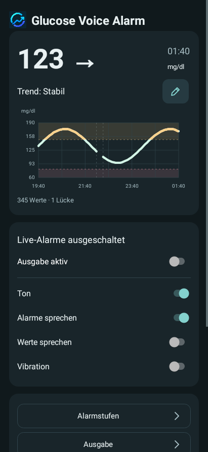
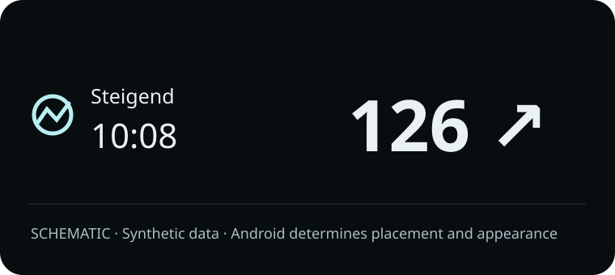
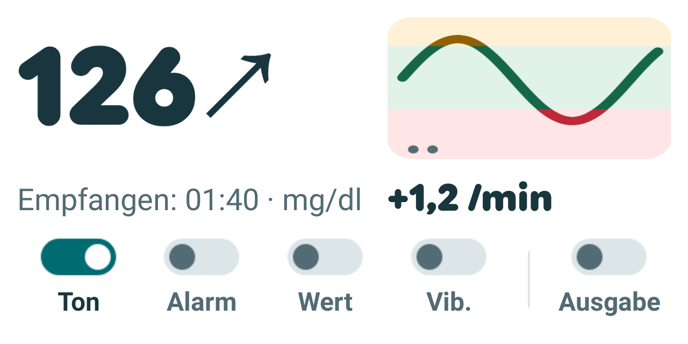
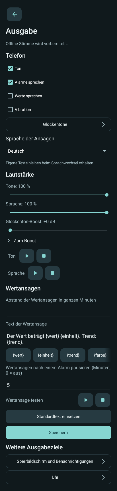
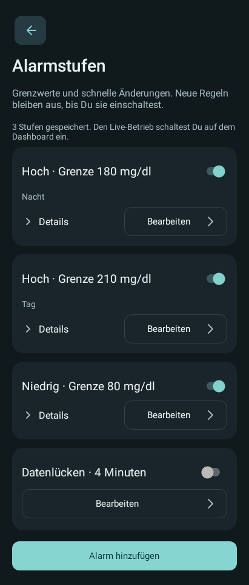
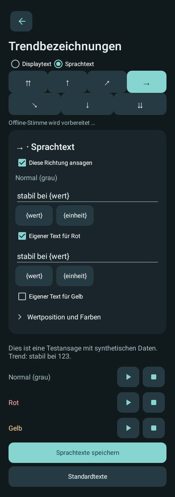

# Glucose Voice Alarm — phone

[Project overview](../README.md) · [Deutsch](README.de.md) · [GVA Watch](../companionWear/README.md) · [GVA Dots](../companionWatchFace/README.md)

The phone app receives supported CamAPS notifications, evaluates its configured alarms and supplies all other GVA displays. Version **0.30.0 Beta**. The phone works without either watch component.

**Experimental research tool; not for medical use or treatment decisions.** Read [SAFETY.md](../SAFETY.md). CamAPS continues to control the sensor and pump.

## Examples

Synthetic examples. Dashboard and setting images are native app renderings; the AOD image is a schematic of the information requested from Android, not a Pixel screenshot. Android controls its actual appearance.

<table><tr><td valign="top"> Dashboard</td><td valign="top"> AOD · schematic   Widget · light mode</td></tr></table>

Example settings

<table><tr><td valign="top"> Output</td><td valign="top"> Alarm levels</td><td valign="top"> Trend names</td></tr></table>

Each widget has a preview and its own system, app or custom colors. Background opacity, chart opacity and horizontal/vertical padding can be adjusted separately. Choose one or two hours: one or two dots inside the chart indicate the window. The larger chart retains the existing reading and arrow size and leaves a gap before the delta below. The original receipt caption follows the app language. Tap the reading/arrow to open CamAPS and the chart area to open GVA. If CamAPS is unavailable, the left area also opens GVA. The optional toggle row controls sound, alarm speech, reading speech, vibration and output; missing prerequisites open setup.

## Output and settings

Multiple alarm levels retain their own sound, speech and vibration routes, with repeat and snooze where supported. Routine reading speech has its own interval and can pause after an alarm. Five local profiles preserve output and display text settings. See the [phone reference](../docs/PHONE_REFERENCE.md).

The main navigation separates Alarm levels, Output, Trend names, Android permissions, Profiles, History & diagnostics, and general Settings. Alarm levels start as compact cards, sorted by type and threshold. One Add alarm button opens the type picker. Delete is in the level editor and requires confirmation. The six-hour chart uses a stronger line with the same threshold colors as the widget.

Under Trend names, choose display or speech text and a direction. Every selector uses ⇈, ↑, ↗, →, ↘, ↓, ⇊. Red and yellow inherit the normal word until their own text is enabled. Display and speech are saved separately. Spoken trend text supports {value}/{wert} and {unit}/{einheit}. If the selected phrase contains the value variable, the value moves there and its original value part is removed. Without it, the existing reading announcement remains. Previews display and speak synthetic data.

The display distinguishes “Trend open” when no arrow is present from “Assign arrow” for a graphic awaiting assignment. On the dashboard these read “Trend: open” and “Trend: Assign arrow”. Unknown trends remain omitted from speech. Stale AOD readings still show their age.

Android permissions have separate rows with a green checkmark, red exclamation mark, or a neutral state for unavailable or uncheckable functions. History & diagnostics provides reception and output checks and an optional technical summary to copy. Auditions use consistent play/stop controls. Updates retain settings and profiles; enable output again yourself afterwards.

## Colored arrows and custom trend words

Arrow assignment shows seven directions with three colors each in a compact grid. The source preview stays visible above it; choices scroll separately from the actions. Red and yellow require explicit assignment for the exact graphic. A similar shape alone does not confirm color. Existing mappings stay normal until you reassign that graphic.

CamAPS places its white arrow on a colored background. GVA colors the arrow itself. Fresh arrows can be normal, red or yellow; stale data stays gray. The trend line uses “Trend:” instead of a fixed source name.

Edit displayed words under Trend names → Display text and spoken words separately under Trend names → Speech text. For each of the seven directions, red and yellow initially inherit the normal/gray word. Enable the color's checkbox to use its own text. On first activation, an empty field is seeded with the current base word. Turning it off preserves that text and follows the base again; an active empty field also follows the base. Display words allow up to 40 characters and spoken words up to 80, on a single line. Display text is literal; speech text accepts `{value}`/`{wert}` and `{unit}`/`{einheit}`. A value placeholder moves the reading to that position; without one, the existing reading introduction remains. The speech enable switch for a direction applies to all its colors. Profiles preserve both text groups and their color switches.

The optional `{color}` placeholder (also `{farbe}`) adds “red” or “yellow” in supported speech templates. It is empty for normal or unknown arrows. Example: `{value} {trend} {color}`. Color is not automatically appended to a trend word; existing templates are preserved. Custom color words and this placeholder work independently.

## Low soon

Under Alarm levels → Add alarm → Low soon, create a separate warning level. New levels start off. Its editable default text is “According to the data source, low soon.” Choose its schedule, sound, speech and vibration; it has no separate numeric threshold, repeat or snooze setting.

The source signal is a freshly received, recognized red arrow in any direction. The reading must also be strictly above the highest enabled low threshold whose schedule currently applies. With no active low level there is no fallback threshold. At or below that boundary, the existing low alarm applies. GVA does not calculate this forecast from rates or pump data.

The warning occurs once per red phase. A new recognized normal or yellow arrow rearms it for the next red phase. Unknown arrows, gaps, a low value or a restart do not reset that claim. There is no timed repetition. Usual freshness checks, output switches, pauses and schedules still apply. If a blocked output route prevents the warning from starting, it can start later in the same red phase when conditions are met.

## Persistent-high duration

Duration starts with the first valid received reading above this persistent-high level's threshold. It includes stable or falling readings and time without data. A fresh reading at or below that threshold ends the episode. Missing, invalid or stale data does not confirm that it has ended.

Once GVA detects a data gap or receipt is stale, it does not issue a current reading-based alarm. The persistent-high trigger still requires a fresh rising reading and the imported xDrip data-quality check, which includes a minimum sampling density and a one-day limit. Elapsed duration alone therefore does not guarantee output. The alarm repeat deadline remains separate.

After a gap, rate calculations use only new contiguous readings. For persistent-high quality checks, GVA separately retains up to 500 actual receipts within the running service. It does not estimate missing readings. Chart gaps remain visible even if CamAPS later fills its own history; those retrospective points are not imported from the notification.

Reloading settings or restarting the service within the same phone boot does not discard the saved beginning solely because receipt was interrupted. A real clock or boot discontinuity starts the check again conservatively. Changed alarm conditions are reconciled with stored state as before. An update does not reconstruct a beginning already discarded by an older version.

## New high/low alarm episodes

For high/low alarms, the automatic repeat interval applies within one continuous alarm episode per level. A fresh valid reading below the high threshold or above the low threshold ends that episode. Crossing the threshold again can trigger a new first alarm through the enabled speech, sound and vibration routes. A reading exactly on the threshold still meets the existing alarm condition.

This numerical recovery does not cancel manual snooze or the global pause. Data gaps, invalid or stale readings and a closed schedule alone do not reset the repeat. A missing trend arrow does not change the assessment of a valid numeric reading. Multiple levels in the same direction retain their own deadlines when a higher level starts. A previously announced lower level that remains continuously exceeded therefore does not restart early when the higher level subsides.

Updates do not retrospectively clear stored deadlines. The new policy needs a newly received valid reading back inside the relevant threshold. A separate persistent condition notification with the suppression reason and remaining time is not yet implemented.

## Processing diagnostics

History & diagnostics groups reception and output checks. Function check separates the last new input, alarm attempt and output attempt and distinguishes a new alarm from a silent notification refresh. Sound, speech and vibration status remain separate. If needed, copy the technical summary there; it contains fixed status codes rather than readings or spoken text. A successful API call does not establish that sound or vibration was perceptible. These bounded snapshots are not an event history.

## Speech after voice initialization

If the offline voice is still initializing when a live reading alarm starts through sound or vibration, its missing speech may follow once within ten seconds of alarm start. GVA first rechecks the current alarm condition, schedule and freshness of the available data, then renders the text with the current reading. Sound and vibration are not repeated. Speech is omitted when the deadline has passed or the condition no longer holds. Switching output off, pausing, losing the source, or changing settings or arrow mappings discards the pending speech. A service restart does not restore it. Manual and synthetic previews and data-gap warnings do not use this deferred speech path.

## Arrow mappings

The pencil beside the dashboard trend remains available for known arrows, so an existing mapping can be checked and corrected. The dialog holds its graphic preview fixed; after a new CamAPS notification, reload it before saving. If no current graphic is available, a message explains that the next update is needed. A correction stops current and pending GVA audio. The last displayed reading and its original receipt time remain available; output waits for new input. Arrow mappings stay in private app storage and are included in neither this source project nor settings profiles.

## Build and set up

Follow [Build from source](../docs/BUILDING.md). Build target: `:companionProbe:assembleDebug`. Minimum declared Android API: 26; large native metric/live display: Android 17/API 37 when available. A normal notification is the fallback.

1. Install your own APK and acknowledge both safety notices yourself.
2. Enable notification access and receipt; allow app notifications and review background/battery settings.
3. Configure levels, outputs and an offline speech voice. Check synthetic previews and actual sound/vibration on your device.
4. Enable **Output enabled** on the dashboard. Enable it again after an update.
5. Optional: add the widget, or pair GVA Watch and separately enable display and alarm forwarding.

The phone/watch pair requires matching package names and signing keys. The app has no Internet or direct sensor permission. Settings, mappings, alarm state and a short diagnostic history stay in private app storage. Do not upload personal readings or device dumps to issues.

See [current limitations](../docs/STATUS.md), [GPLv3](../LICENSE) and [third-party notices](../THIRD_PARTY_NOTICES.md).
