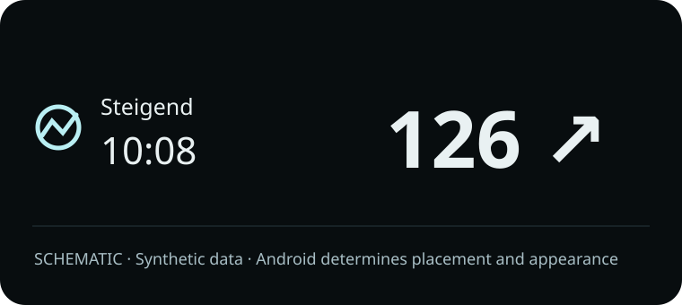
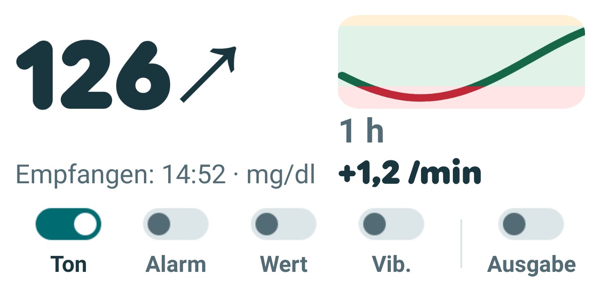
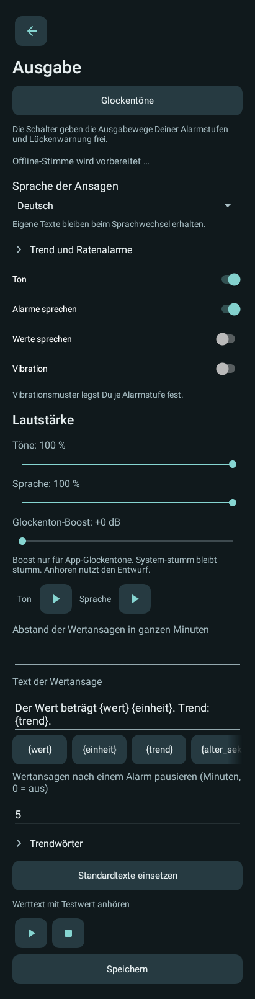
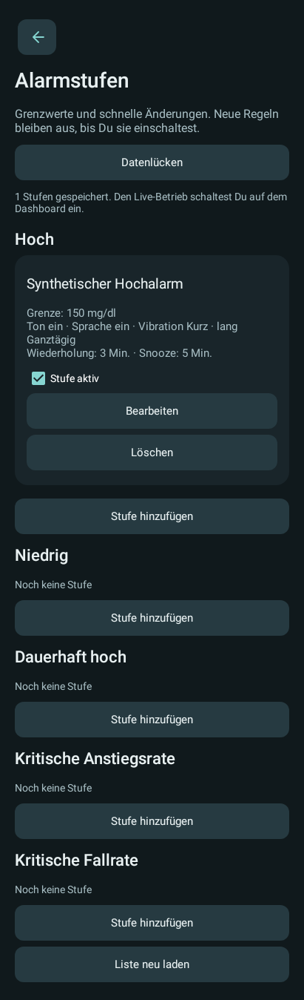
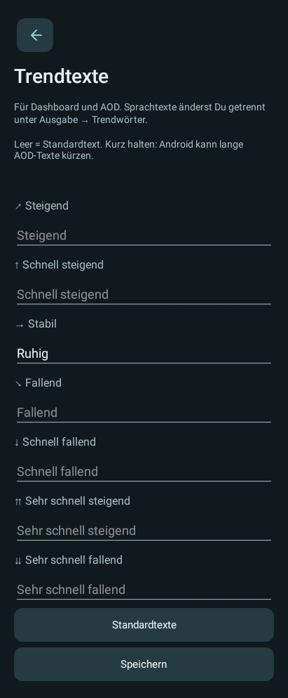

# Glucose Voice Alarm — phone

[Project overview](../README.md) · [Deutsch](README.de.md) · [GVA Watch](../companionWear/README.md) · [GVA Dots](../companionWatchFace/README.md)

The phone app receives supported CamAPS notifications, evaluates its configured alarms and supplies all other GVA displays. Version **0.21.4 Beta**. The phone works without either watch component.

**Experimental research tool; not for medical use or treatment decisions.** Read [SAFETY.md](../SAFETY.md). CamAPS continues to control the sensor and pump.

## Examples

Synthetic examples. Dashboard and setting images are native app renderings; the AOD image is a schematic of the information requested from Android, not a Pixel screenshot. Android controls its actual appearance.

<table><tr><td valign="top"> Dashboard</td><td valign="top"> AOD · schematic   Widget · light mode</td></tr></table>

Example settings

<table><tr><td valign="top"> Output</td><td valign="top"> Alarm levels</td><td valign="top"> Display trend text</td></tr></table>

The widget has an optional single row of sound, alarm speech, reading speech, vibration and output toggles. They switch directly when their prerequisites are met; required setup opens the app. Its chart shows labeled 30-minute, one-hour or two-hour windows as width changes. Rounded numerals keep their size limit while the arrow grows into available space at wider sizes. The receipt caption follows the app language: "Received: HH:mm" in English and "Empfangen: HH:mm" in German. The remaining surface opens the dashboard.

## Output and settings

Configure multiple alarm levels, individual tone/speech/vibration choices, repeats and snooze where applicable. Routine value announcements have their own interval and can pause after an alarm. Spoken templates and all seven spoken trend phrases can be edited; unchecked phrases are omitted. Appearance → Display trend text edits the dashboard/AOD labels separately. Blank labels follow the UI language. Double-arrow defaults are "Rising very fast" and "Falling very fast"; saved speech text is retained. Five local profiles store both text sets independently. See the [detailed phone reference](../docs/PHONE_REFERENCE.md).

The CamAPS arrow is separate from the app's numeric rate calculation. A numeric critical-rate alarm can trigger without a recognized arrow when enough fresh values arrive. The optional data-gap warning uses the last known situation; it never estimates a current value.

## Arrow mappings

The pencil beside the dashboard trend remains available for known arrows, so an existing mapping can be checked and corrected. The dialog holds its graphic preview fixed; after a new CamAPS notification, reload it before saving. If no current graphic is available, a message explains that the next update is needed. A correction stops current and pending GVA audio. The last displayed reading and its original receipt time remain available; output waits for new input. Arrow mappings stay in private app storage and are included in neither this source project nor settings profiles.

## Build and set up

Follow [Build from source](../docs/BUILDING.md). Build target: `:companionProbe:assembleDebug`. Minimum declared Android API: 26; large native metric/live display: Android 17/API 37 when available. A normal notification is the fallback.

1. Install your own APK and acknowledge both safety notices yourself.
2. Enable notification access and receipt; allow app notifications and review background/battery settings.
3. Configure levels, outputs and an offline speech voice. Check synthetic previews and actual sound/vibration on your device.
4. Enable **Output enabled** on the dashboard. Enable it again after an update.
5. Optional: add the widget, or pair GVA Watch and separately enable display and alarm forwarding.

The phone/watch pair requires matching package names and signing keys. The app has no Internet or direct sensor permission. Settings, mappings, alarm state and a short diagnostic history stay in private app storage. Do not upload personal readings or device dumps to issues.

See [current limitations](../docs/STATUS.md), [GPLv3](../LICENSE) and [third-party notices](../THIRD_PARTY_NOTICES.md).
