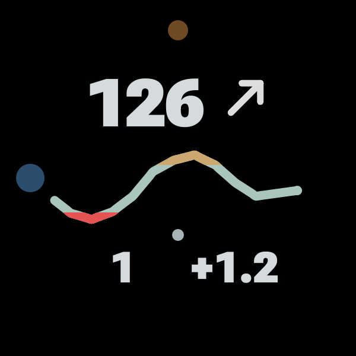

# GVA Dots

[Project overview](../README.md) · [Deutsch](README.de.md) · [GVA Watch](../companionWear/README.md) · [Phone](../companionProbe/README.md)

**0.1.5 Beta.** A code-free Watch Face Format v1 face for a round Wear OS display. It uses GVA Watch's composite and age complication sources. There is no independent glucose receipt or alarm engine in the face.

**Experimental research tool, not for medical use.** Read [SAFETY.md](../SAFETY.md). Missing or stale display data is not a dependable warning of a phone or connection failure.

## Examples

Synthetic previews drawn with GVA's renderer and the face's clock/age arrangement. These are not photographs or captures of a person's watch.

<table><tr><td valign="top"> Active · preview</td><td valign="top"> Ambient · preview</td></tr></table>

- Large reading and CamAPS arrow above a one-/two-hour curve.
- Lower-left elapsed minutes since receipt; lower-right numeric delta per minute in the phone's selected unit. One or two small dots show the history window.
- A larger blue hour dot and smaller orange minute dot at the rim. The orange dot draws above the blue dot when they overlap.
- Ambient view dims data and time dots and removes the chart background. The watch controls ambient updates and visibility.

## Build and select

Build target `:companionWatchFace:assembleDebug` from `watch-build/` with JDK 21/SDK 35. WFF v1 requires Wear OS 4 or later. See [Build from source](../docs/BUILDING.md).

Install GVA Watch and pair it with the phone first. Install the face APK, select GVA Dots yourself, then check both slots: **GVA · Wert und Kurve** and **GVA · Alter (Min.)**. They are supplied by GVA Watch. If a source is not assigned automatically, choose it in the face editor. To change one or two hours, open GVA Watch's menu; the face uses the same setting.

The Watch5 Pro appearance was accepted during development; update cadence and battery cost still need everyday testing. AOD was confirmed while worn; a desk/charger is not a reliable ambient-mode test. [Current limitations](../docs/STATUS.md).

Face source: [GPL-3.0-or-later](../LICENSE). Roboto Flex fonts: SIL OFL 1.1, with full notices included. [Credits and licenses](../THIRD_PARTY_NOTICES.md).
