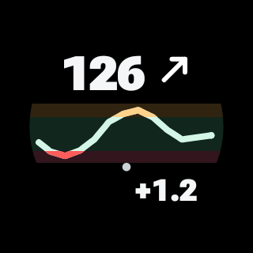
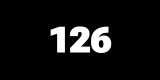

# GVA Watch

[Project overview](../README.md) · [Deutsch](README.de.md) · [Phone](../companionProbe/README.md) · [GVA Dots face](../companionWatchFace/README.md)

**0.19.0 Beta.** One watch APK contains the GVA display, its tile and all six complication sources. It receives data from the phone; no CamAPS watch app, direct sensor link or independent glucose alarm engine is included.

**Experimental research tool, not for medical use.** Read [the safety information](../SAFETY.md). The watch cannot independently warn when the phone or connection fails.

## Examples

Synthetic native renderings. The app display and tile share their data layout. GVA Dots adds the watch-face clock dots and its separate age slot.

<table><tr><td valign="top"> Shared round display · preview</td><td valign="top"> Tile · no clock dots</td></tr></table>

## Six complication sources

These are data sources inside GVA Watch, not six apps. Choose them in a compatible face's editor. Short-text images below illustrate the supplied content; the selected face controls font, size, layout and colors. Graphic images come from GVA's native renderer.

| Source | Example | Compatible slot |
|---|---|---|
| Value and curve |  | Small image; also supports short value-and-arrow text |
| Age in minutes |  | Short text |
| Glucose value |  | Short text |
| CamAPS trend |  | Short text or monochrome icon |
| Delta per minute |  | Short text |
| Curve |  | Small image |

GVA Dots uses the composite image and age sources. Other faces may use any compatible source separately. The shared one-/two-hour setting applies to the chart. A small round slot can make the wide curve difficult to read.

## Setup and alerts

Build both phone and watch from the same source checkout with the same signing key. See [Build from source](../docs/BUILDING.md). Watch build target: `:companionWear:assembleDebug` in `watch-build/` (JDK 21/SDK 35). The declared minimum is API 30; the tested watch is a Watch5 Pro on Wear OS 6. Newer dynamic-age features depend on platform support.

1. Open GVA Watch and personally acknowledge both notices.
2. On the phone, enable Appearance → Watch → Send readings to watch. This starts off and is separate from the alarm master.
3. Add the GVA tile or select complication sources yourself. Tap the app display for its menu and one-/two-hour choice.
4. For alerts, separately enable phone alert forwarding and watch alarm reception; grant watch notification permission. Use the labeled test first.

Only accepted phone alarms and data-gap warnings are forwarded. The watch creates notifications with two short vibration pulses. Both opt-ins start off. There is no routine value-notification stream, no offline replay and no independent watch alarm calculation. Dismissing a watch card does not acknowledge or snooze the phone alarm. Do Not Disturb, notification settings and connection state can prevent delivery or vibration.

## Freshness and limits

Data comes from the accepted phone snapshot. Reconnection and resending preserve its age. After four minutes, the individual trend and delta sources become empty. The composite face may retain the last known reading and old arrow in gray, without delta; the shared display window is at most two hours. Missing data is never estimated. A separate age source supplies elapsed minutes.

Wear OS controls actual tile/complication refresh times, especially in ambient mode. The regular refresh interval is five minutes; new data requests updates, but dependable one-minute behavior is not established for every surface. Background behavior, alarm delivery/perceptibility and battery use need further device testing. [Current status](../docs/STATUS.md).

GVA code is [GPL-3.0-or-later](../LICENSE). Roboto Flex remains under SIL OFL 1.1; AndroidX and Google Play services retain their respective licenses and terms. See [third-party notices](../THIRD_PARTY_NOTICES.md).
